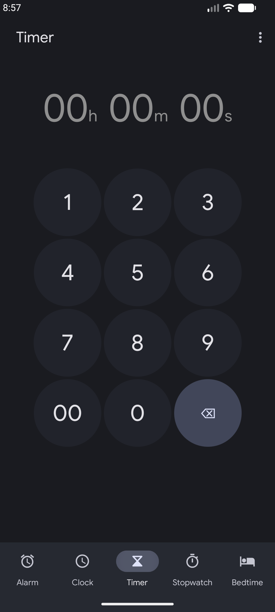
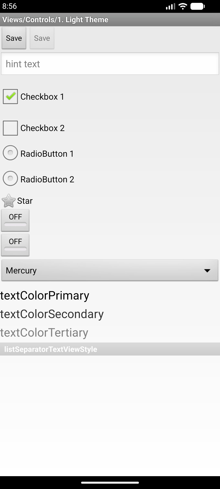
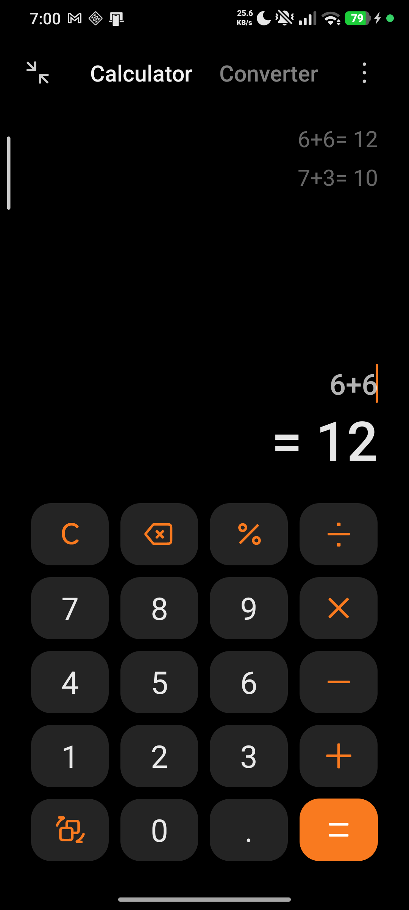
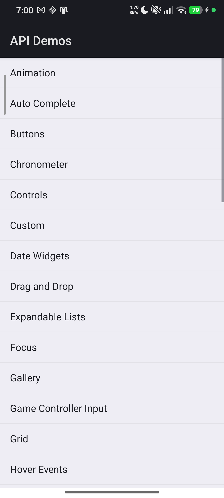
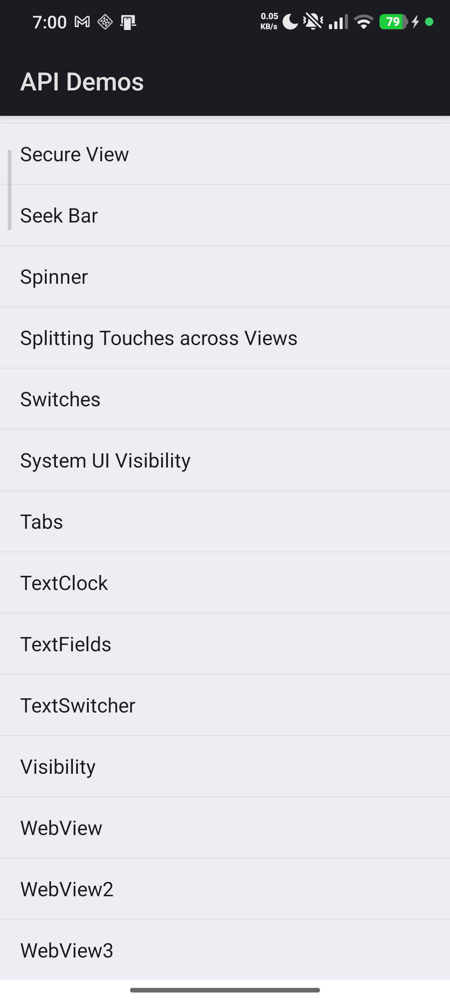
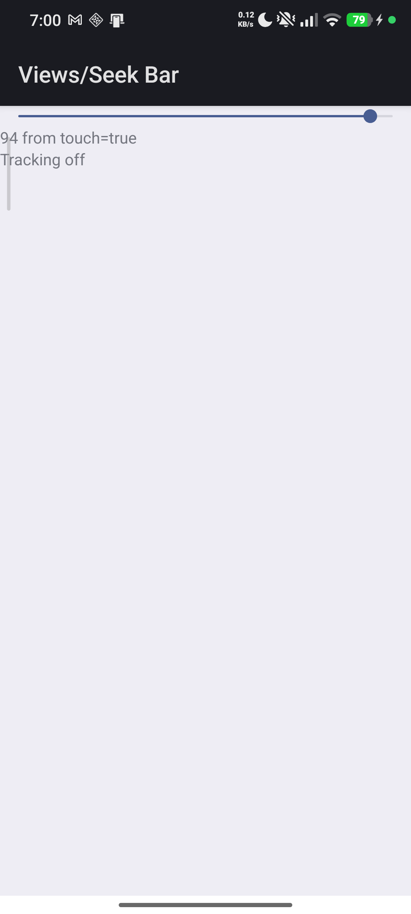
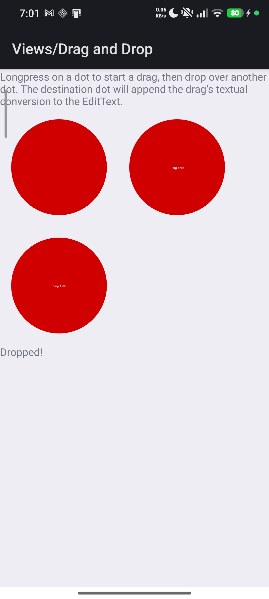
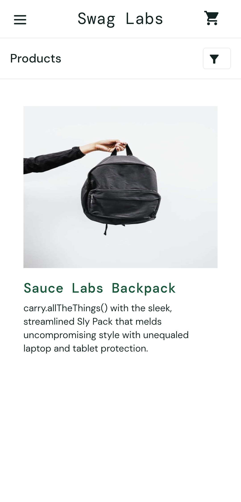
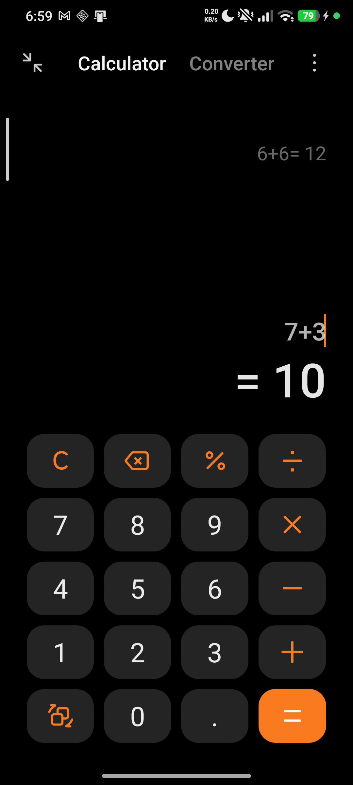

# Appium Mobile Automation — Mini Task

Automated mobile tests written in **Java** with **Appium 3** (`uiautomator2` driver),
the **Appium Java Client 9**, **TestNG** and **Maven**. The project covers the full mini task.

| Phase | What it contains | Test class(es) |
|-------|------------------|----------------|
| 1 | Windows/Android environment setup | `README.md` (this file) + [`docs/appium-doctor-output.txt`](docs/appium-doctor-output.txt) |
| 2 | Built-in app test + real APK test | `BuiltInAppEmulatorTest` / `BuiltInAppTest`, `ApkInstallTest` |
| 3 | Real device run + 4 gestures | `RealDeviceTest`, `TapGestureTest`, `ScrollGestureTest`, `SlideGestureTest`, `DragAndDropGestureTest` |
| 4 | Mobile web test in Chrome | `ChromeWebTest` |
| 5 | Appium Java cheat sheet | [`docs/appium-java-cheatsheet.md`](docs/appium-java-cheatsheet.md) |

> Real-world Windows/real-device issues and how they were solved are documented in
> [`docs/setup-notes.md`](docs/setup-notes.md).

### Evidence

| | | |
|---|---|---|
|  |  |  |
| **Phase 2** — built-in Google Clock on the AVD | **Phase 2** — ApiDemos APK on the AVD | **Phase 3** — Calculator on the physical device |
|  |  |  |
| **Phase 3** — Tap gesture | **Phase 3** — Scroll gesture | **Phase 3** — Slide gesture |
|  |  |  |
| **Phase 3** — Drag & drop | **Phase 4** — Chrome web test | **Phase 2** — Calculator 7 + 3 = 10 |

---

## 1. Project structure

```
.
├── apps/                                  # put ApiDemos-debug.apk here (git-ignored)
├── docs/
│   ├── appium-java-cheatsheet.md          # Phase 5 deliverable
│   ├── appium-doctor-output.txt           # Phase 1 evidence (all necessary checks green)
│   ├── setup-notes.md                     # real-world troubleshooting notes
│   └── screenshots/                       # captured evidence for every scenario
├── src
│   ├── main/java/com/mahmoud/appium
│   │   ├── config
│   │   │   ├── ConfigReader.java          # reads config.properties (+ -D overrides)
│   │   │   └── CapabilitiesFactory.java   # builds every Desired Capabilities set
│   │   ├── pages                          # Page Objects
│   │   │   ├── BasePage.java
│   │   │   ├── CalculatorPage.java
│   │   │   ├── ClockPage.java             # built-in Google Clock (emulator scenario)
│   │   │   ├── ApiDemosPage.java
│   │   │   └── ChromeLoginPage.java
│   │   └── utils
│   │       ├── Gestures.java              # W3C tap / scroll / slide / drag & drop
│   │       └── ScreenshotUtil.java
│   └── test
│       ├── java/com/mahmoud/appium
│       │   ├── base/BaseTest.java         # shared driver setup/teardown
│       │   ├── phase2/...
│       │   ├── phase3/...
│       │   └── phase4/ChromeWebTest.java
│       └── resources/config.properties    # device + app configuration
├── pom.xml
├── testng.xml                             # device-neutral suite
└── testng-emulator.xml                    # emulator-only suite (Google Play image)
```

---

## 2. Environment setup (Phase 1 — Windows + Android)

Install the following and add them to `PATH`.

1. **Java JDK 11+**
   - Install a JDK (e.g. Temurin 17).
   - Set `JAVA_HOME` to the JDK folder, e.g. `C:\Program Files\Eclipse Adoptium\jdk-17`.
   - Verify: `java -version`.

2. **Node.js (LTS)** — https://nodejs.org
   - Verify: `node -v` and `npm -v`.

3. **Appium 3 server** (https://appium.io)
   ```powershell
   npm install -g appium
   appium driver install uiautomator2
   appium -v
   ```
   This project was verified with **Appium 3.8.0** + **uiautomator2 8.7.0**.

4. **Appium Inspector** (element locators) — https://github.com/appium/appium-inspector/releases
   - Download the Windows `.exe` and install.

5. **Android Studio + SDK**
   - Install Android Studio, then in **SDK Manager** install `Android SDK Platform`, `Android SDK Platform-Tools`, `Android SDK Build-Tools` and `Android SDK Command-line Tools`.
   - Also install a **system image** (e.g. `Android 36.1 → Google Play → x86_64`). An AVD
     created without its system image will **not boot** — see
     [`docs/setup-notes.md` §9](docs/setup-notes.md).
   - Create an **AVD** in **Device Manager** (this project used `Medium_Phone_API_36.1`,
     a Google Play image, API 36.1).
   - Set the environment variables:
     ```
     ANDROID_HOME = %LOCALAPPDATA%\Android\Sdk
     ANDROID_SDK_ROOT = %LOCALAPPDATA%\Android\Sdk
     JAVA_HOME = C:\Program Files\Android\Android Studio\jbr
     PATH = ...;%ANDROID_HOME%\platform-tools;%ANDROID_HOME%\emulator;%JAVA_HOME%\bin
     ```
     On Windows, set them with:
     ```powershell
     [Environment]::SetEnvironmentVariable('ANDROID_HOME',"$env:LOCALAPPDATA\Android\Sdk",'User')
     [Environment]::SetEnvironmentVariable('ANDROID_SDK_ROOT',"$env:LOCALAPPDATA\Android\Sdk",'User')
     [Environment]::SetEnvironmentVariable('JAVA_HOME','C:\Program Files\Android\Android Studio\jbr','User')
     ```
     The **Appium server process** must inherit these, or session creation fails with
     *"Neither ANDROID_HOME nor ANDROID_SDK_ROOT environment variable was exported"*.
   - Verify:
     ```powershell
     adb devices
     emulator -list-avds
     ```

   > **Note:** a `google_apis_playstore` image does **not** contain Google Calculator.
   > The emulator built-in-app scenario therefore uses the pre-installed
   > **Google Clock** — see [Running the emulator suite](#running-the-emulator-suite).

6. **appium-doctor** — confirm the setup is clean
   ```powershell
   npm install -g appium-doctor
   appium-doctor --android
   ```
   All **necessary** checks should be green (`no fix needed`). The captured output of
   the final clean run is saved at [`docs/appium-doctor-output.txt`](docs/appium-doctor-output.txt)
   and rendered as an image in [`docs/screenshots/appium-doctor.png`](docs/screenshots/appium-doctor.png)
   (deliverable). Optional-dependency warnings (opencv4nodejs, mjpeg-consumer,
   bundletool, gstreamer) are informational only.

7. **Maven** — https://maven.apache.org/download.cgi
   - `winget` has **no** Apache.Maven package, so install the binary zip manually:
     extract to e.g. `C:\Tools\apache-maven-3.9.9`, then:
     ```powershell
     [Environment]::SetEnvironmentVariable('MAVEN_HOME','C:\Tools\apache-maven-3.9.9','User')
     # then add %MAVEN_HOME%\bin to the user PATH
     ```
   - Verify: `mvn -v`.

### Getting the APK under test
Download the ApiDemos sample APK (**v6.0.18** — the version the page objects were
verified against) and place it at `apps/ApiDemos-debug.apk`:
https://github.com/appium/android-apidemos/releases/download/v6.0.18/ApiDemos-debug.apk

### Dependencies
Declared in `pom.xml`:
- `io.appium:java-client:9.3.0` — Appium Java Client 9
- `org.selenium:selenium-bom:4.25.0` — **pinned** via BOM. Java-client 9.3.0 only
  declares the range `[4.19.0, 5.0)`, and Selenium 4.26+ removed `ContextAware`/
  `getCenter()` and changed `createPointerDown` to take an `int`. Pinning 4.25.0
  keeps `Gestures.java` compiling.
- `org.testng:testng:7.10.2`

---

## 3. Start the Appium server

```powershell
appium
```
It listens on `http://127.0.0.1:4723` (the URL in `config.properties`).

For the **Chrome web test**, Appium must download a chromedriver that matches the
Chrome version on the device. Start the server with the (insecure) auto-download
feature enabled — Appium 3 requires the driver-qualified name:

```powershell
appium --allow-insecure "*:chromedriver_autodownload"
```

Start the emulator (or connect a phone by USB with USB Debugging enabled):
```powershell
emulator -avd Medium_Phone_API_36.1
adb devices
```

> Tip: `-Dtest=...` and `mvn test` both honour the `deviceName`/`udid` in
> `config.properties`, so you can keep the emulator on `emulator-5554` and the
> phone on its udid and switch by passing `-Dudid=...`.

---

## 4. Configuration

Everything lives in `src/test/resources/config.properties`. Any value can be
overridden from the command line with `-Dkey=value`, for example:

```powershell
mvn test -DdeviceName=emulator-5554
mvn test -DplatformVersion=16.0
mvn test -Dudid=RF8M123ABCD        # target a specific real device
```

Key groups:

| Prefix | Purpose |
|--------|---------|
| `appium.server.url` | Appium server endpoint |
| `deviceName`, `udid`, `platformVersion` | Device targeting |
| `calculator.*` | Calculator package/activity + element ids (vendor-specific) |
| `clock.*` | Google Clock package/activity (emulator built-in-app scenario) |
| `apidemos.*` | APK path, package and activity |
| `chrome.*` | URL and credentials for the web test |

---

## 5. Running the tests

Run everything listed in `testng.xml`:
```powershell
mvn test
```

Run a single phase/scenario with TestNG + Surefire:
```powershell
# Phase 2 - built-in app on the emulator (Google Clock)
mvn test -Dtest=BuiltInAppEmulatorTest
# Phase 2 - built-in app (Google Calculator)
mvn test -Dtest=BuiltInAppTest
# Phase 2 - APK
mvn test -Dtest=ApkInstallTest
# Phase 3 - gestures
mvn test -Dtest=TapGestureTest
mvn test -Dtest=ScrollGestureTest
mvn test -Dtest=SlideGestureTest
mvn test -Dtest=DragAndDropGestureTest
# Phase 3 - real device (also set -Dudid=...)
mvn test -Dtest=RealDeviceTest -Dudid=YOUR_DEVICE_ID
# Phase 4 - Chrome web test
mvn test -Dtest=ChromeWebTest
```

> When running a single `-Dtest=...` class, Surefire ignores `testng.xml`, so the
> other classes are not executed.

### Running the emulator suite

Google Play AVD images (e.g. `google_apis_playstore`) do **not** ship Google
Calculator, so the emulator built-in-app scenario uses the pre-installed **Google
Clock** instead. Run both emulator scenarios with:

```powershell
mvn test -Dsurefire.suiteXmlFiles=testng-emulator.xml
```

If your AVD **does** have Google Calculator, run it directly:
```powershell
mvn test -Dtest=BuiltInAppTest
```

### Running on a real device (example: Xiaomi / MIUI)

The default capabilities target the Google Calculator on an emulator. On a
physical Xiaomi device the built-in calculator is MIUI, so override the package,
activity and the "equals" button id on the command line:

```powershell
mvn test "-Dtest=BuiltInAppTest,RealDeviceTest" `
  -Dudid=YOUR_DEVICE_ID -DdeviceName=YOUR_DEVICE_ID `
  -Dcalculator.appPackage=com.miui.calculator `
  -Dcalculator.appActivity=com.miui.calculator.cal.CalculatorActivity `
  -Dcalculator.equalsId=btn_equal_s
```

The APK, gesture and Chrome tests need no app-specific overrides — just pass the
`udid`:

```powershell
mvn test "-Dtest=ApkInstallTest,TapGestureTest,ScrollGestureTest,SlideGestureTest,DragAndDropGestureTest,ChromeWebTest" `
  -Dudid=YOUR_DEVICE_ID -DdeviceName=YOUR_DEVICE_ID
```

### Where results go
- TestNG/Surefire reports: `target/surefire-reports/`
- Screenshots taken by the tests: `target/screenshots/`
- The final, curated screenshots are committed under [`docs/screenshots/`](docs/screenshots/).

### Verified results

**Real device — Xiaomi 24117RN76G, Android 16 / MIUI, udid `4lucqgjfssinxg95`**

The full suite ran end-to-end against the physically connected phone in a single
run — `mvn test` → **Tests run: 8, Failures: 0, Errors: 0** (BUILD SUCCESS, ~127 s).

| Test class | Result | Evidence |
|------------|--------|----------|
| `BuiltInAppTest` (MIUI Calculator, 7 + 3 = 10) | PASS | `phase2-builtin-calculator.png` |
| `ApkInstallTest` | PASS | `phase2-apk-checkbox.png` |
| `RealDeviceTest` | PASS | `phase3-real-device-calculator.png` |
| `TapGestureTest` | PASS | `phase3-gesture-tap.png` |
| `ScrollGestureTest` | PASS | `phase3-gesture-scroll.png` |
| `SlideGestureTest` | PASS | `phase3-gesture-slide.png` |
| `DragAndDropGestureTest` | PASS | `phase3-gesture-drag-drop.png` |
| `ChromeWebTest` (SauceDemo in Chrome) | PASS | `phase4-chrome-web.png` |

**AVD emulator — `Medium_Phone_API_36.1` (Google Play image, Android 16), udid `emulator-5554`**

```powershell
mvn test -Dsurefire.suiteXmlFiles=testng-emulator.xml
```

| Test class | Result | Evidence |
|------------|--------|----------|
| `BuiltInAppEmulatorTest` (Google Clock → Timer tab) | PASS | `phase2-builtin-app-emulator-clock.png` |
| `ApkInstallTest` (ApiDemos → Checkbox 1) | PASS | `phase2-apk-checkbox.png` |

All screenshots referenced above are in [`docs/screenshots/`](docs/screenshots/).

---

## 6. Test scenarios

### Phase 2
- **`BuiltInAppEmulatorTest#openTimerTabInBuiltInClock`** — launches the pre-installed
  Google Clock app, opens the **Timer** tab and asserts the tab became selected.
  This is the emulator (AVD) built-in-app scenario.
- **`BuiltInAppTest#addTwoNumbersInBuiltInCalculator`** — launches the built-in
  Android Calculator, computes `7 + 3` and asserts the result is `10`. Used on
  devices/images that ship Google Calculator.
- **`ApkInstallTest#installApkNavigateAndToggleCheckbox`** — installs
  `ApiDemos-debug.apk`, navigates `Views → Controls` and toggles `Checkbox 1`
  (three element interactions). Runs on both emulator and real device.

### Phase 3
- **`RealDeviceTest`** — the Calculator scenario on a physical device.
- **`TapGestureTest`** — W3C tap on the `Views` row.
- **`ScrollGestureTest`** — repeated W3C swipes until `WebView` is visible.
- **`SlideGestureTest`** — slides the Seek Bar thumb and checks the progress label changed.
- **`DragAndDropGestureTest`** — long-press + drag the dot onto the target dot.

### Phase 4
- **`ChromeWebTest`** — opens SauceDemo in Chrome on Android, logs in with the
  demo account and verifies the products page.

---

## 7. Locator strategy

Locators were identified with **Appium Inspector**. All three strategies required by
the task are used in the Phase 2 tests:

| Strategy | Where it is used | Example |
|----------|------------------|---------|
| **ID** (resource-id) | Calculator digits/operators, ApiDemos widgets, Clock | `By.id("com.miui.calculator:id/btn_equal_s")`, `By.id("io.appium.android.apis:id/check1")` |
| **XPath** | Clock tab-selected check + toolbar title, ApiDemos widget label | `By.xpath("//*[@content-desc=\"Timer\" and @selected=\"true\"]")`, `By.xpath("//*[@text=\"Checkbox 1\"]")` |
| **Accessibility ID** | Google Clock bottom-nav tabs (maps to `content-desc`) | `AppiumBy.accessibilityId("Timer")` |
| UiAutomator (bonus) | ApiDemos menu rows, which have no stable resource-id | `AppiumBy.androidUIAutomator("new UiSelector().text(\"Views\")")` |

| App | Locator type | Example |
|-----|--------------|---------|
| Calculator | resource-id | `com.google.android.calculator:id/eq` (emulator) / `com.miui.calculator:id/btn_equal_s` (MIUI) |
| Google Clock | resource-id + accessibility-id + XPath | `:id/desk_clock_pager`, `accessibilityId("Timer")`, `//*[@text="Timer"]` |
| ApiDemos menus | UiAutomator text | `new UiSelector().text("Views")` |
| ApiDemos widgets | resource-id + XPath | `io.appium.android.apis:id/seek`, `:id/drag_dot_1`, `//*[@text="Checkbox 1"]` |
| Chrome web | id / CSS | `#login-button`, `.title` |

Calculator resource-ids differ between vendors, so they are **not** hard-coded:
they live in `config.properties` under `calculator.*` and can be overridden with
`-Dcalculator.equalsId=...` at runtime (see [above](#running-on-a-real-device-example-xiaomi--miui)).

Google Clock restores whichever tab was open last, so readiness is asserted on
`desk_clock_pager` (present on every tab) rather than a tab-specific id — this
keeps the test repeatable regardless of the app's last state.

If a device image ships different resource-ids, update the constants in the
relevant `*Page` class after inspecting the screen.

---

## 8. Deliverables checklist

- [x] Public GitHub repository with all test scripts + this README.
- [x] `appium-doctor --android` output — [`docs/screenshots/appium-doctor.png`](docs/screenshots/appium-doctor.png) (raw text: [`appium-doctor-output.txt`](docs/appium-doctor-output.txt)) — shows *necessary dependencies completed, no fix needed*.
- [x] Built-in app screenshot **on the AVD emulator** — [`docs/screenshots/phase2-builtin-app-emulator-clock.png`](docs/screenshots/phase2-builtin-app-emulator-clock.png)
- [x] Built-in Calculator screenshot (device with Google Calculator) — `docs/screenshots/phase2-builtin-calculator.png`
- [x] APK screenshot **on the AVD emulator** — [`docs/screenshots/phase2-apk-checkbox.png`](docs/screenshots/phase2-apk-checkbox.png)
- [x] Real-device screenshot — [`docs/screenshots/phase3-real-device-calculator.png`](docs/screenshots/phase3-real-device-calculator.png)
- [x] Gesture screenshots — [`tap`](docs/screenshots/phase3-gesture-tap.png), [`scroll`](docs/screenshots/phase3-gesture-scroll.png), [`slide`](docs/screenshots/phase3-gesture-slide.png), [`drag & drop`](docs/screenshots/phase3-gesture-drag-drop.png)
- [x] Chrome web screenshot — [`docs/screenshots/phase4-chrome-web.png`](docs/screenshots/phase4-chrome-web.png)
- [x] `docs/appium-java-cheatsheet.md` (Phase 5).

Screenshots are written automatically to `target/screenshots/` while the tests run;
the curated, human-named set above lives in `docs/screenshots/`.
